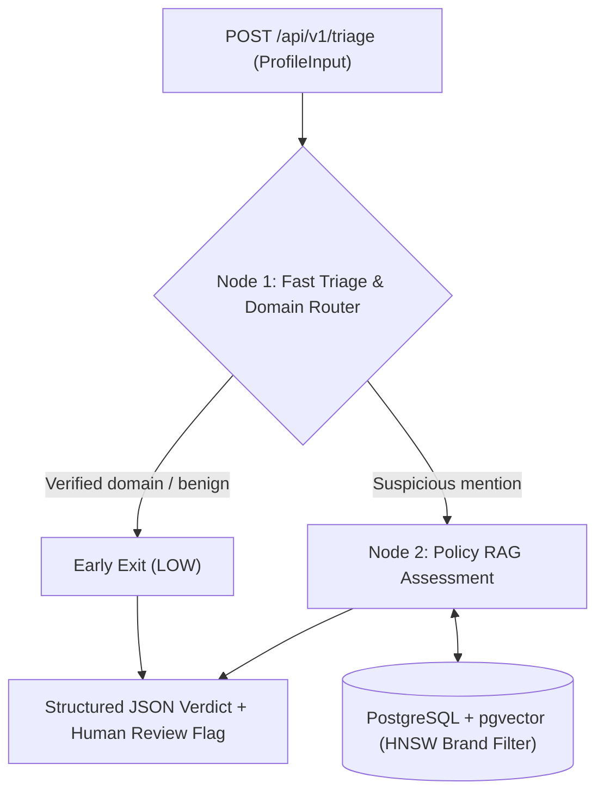

# Brand-Risk Intelligence & RAG Agent


An asynchronous, policy-grounded Trust & Safety triage service built with **FastAPI**, **LangGraph**, **PostgreSQL (`pgvector`)**, and **Pydantic**. Designed to reduce analyst alert fatigue by separating benign brand mentions from high-risk impersonation and phishing accounts.

## Architecture



## Key Engineering Decisions

* **Conditional Graph Routing (`LangGraph`):** Short-circuits verified official domains and non-impersonating mentions before invoking vector search or LLM generation, reducing token cost and tail latency.
* **Multi-Tenant Policy Isolation (`pgvector`):** Uses an HNSW index with brand-level SQL filtering (`WHERE LOWER(brand) = LOWER($2)`) so client policies never bleed across tenants.
* **Strict I/O Contracts (`Pydantic`):** Enforces schema validation on incoming profile payloads and constrains LLM outputs to deterministic risk tiers (`LOW`, `MEDIUM`, `HIGH`), confidence scores, and cited policy IDs.
* **Graceful Zero-Shot Fallback & Privacy:** Uses simulated FinTech (`ApexBank`) and E-Commerce (`SwiftMart`) datasets for safe public benchmarking, falling back cleanly to zero-shot policy reasoning when a brand has no custom rules seeded yet.

## Evaluation Benchmark (`eval/run_eval.py`)

Evaluated concurrently (`asyncio`) across a 10-case curated validation set covering phishing, unauthorized investment groups, fake support accounts, legitimate merchants, and benign commentary:

| Metric | Result |
| :--- | :--- |
| **Validation Set Size** | 10 profiles (2 simulated enterprise brands) |
| **Overall Accuracy** | `100.0%` |
| **High-Risk Precision** | `100.0%` |
| **High-Risk Recall** | `100.0%` |
| **Median Latency** | `1,978 ms` |

## Quickstart

```bash
# 1. Configure environment
cp .env.example .env  # Add your API key and model settings

# 2. Launch FastAPI + PostgreSQL (pgvector)
docker compose up --build -d

# 3. Run automated evaluation benchmark
docker compose exec api python -m eval.run_eval

# 4. Run unit test suite
pytest -v
```

## Future Improvements

* **Batch Throughput:** Add a `POST /api/v1/triage/batch` endpoint using `asyncio.Semaphore` for bulk scraper ingestion.
* **Adversarial Normalization:** Add a pre-triage normalization step to detect leetspeak handles (e.g., `@ap3x_b4nk`) and bilingual Traditional Chinese/English impersonation cues.
* **Hybrid Retrieval:** Combine `pgvector` cosine similarity with PostgreSQL full-text search (`tsvector`) to improve exact keyword matching on policy IDs and domains.